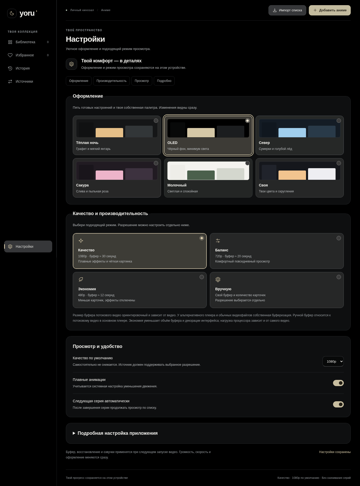
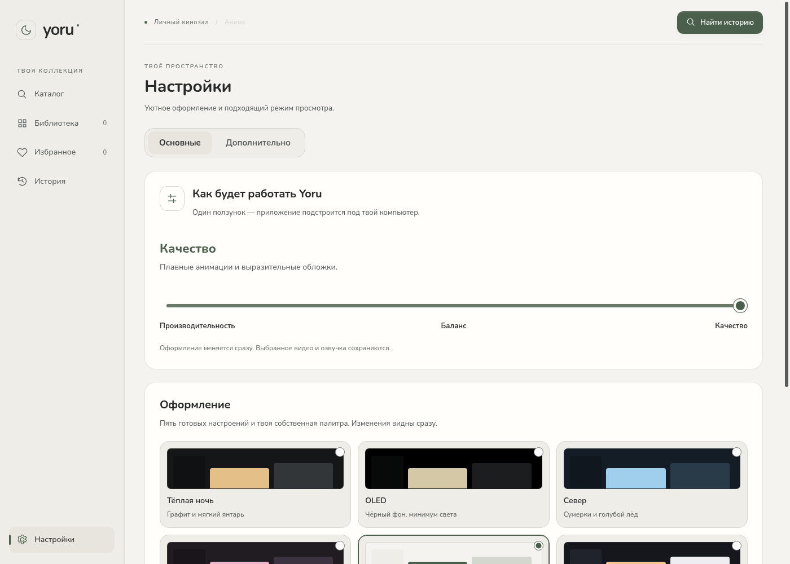

# Yoru — личный кинозал для аниме

**Windows 10/11 · x64 · версия 0.7.1**

Библиотека, продолжение просмотра, выбранная озвучка и свои заметки о персонажах. Пять готовых тем и собственная палитра. Приложение работает с прямыми видеоссылками; страницы плееров сайтов открываются отдельно.


## Новый интерфейс

Полностью обновлены оболочка, библиотека, избранное, история, источники, настройки, просмотр и все диалоги. Общие цвета, типографика, размеры и состояния компонентов заменили накопленные переопределения CSS. Системные рамка и кнопки окна Windows сохранены.

- Спокойные поверхности, сдержанный акцент, SVG-иконки, заметный клавиатурный фокус.
- Настройки с переходами к группам; подробные параметры остались доступны.
- Компактный плеер: основные действия рядом с видео, остальные — в параметрах просмотра.
- Адаптация к небольшому окну, системному контрасту и уменьшению движения.
- OLED с настоящим чёрным фоном; раннее применение сохранённой темы без светлой вспышки страницы.

[Все новые скриншоты](docs/images/README.md) · [Дизайн-система, изменённые файлы и проверки](docs/redesign-0.7.md)

## Темы и собственное оформление

«Тёплая ночь», **OLED**, «Север», «Сакура», «Молочный» и **«Своя»**. В собственной теме настраиваются фон, панели, текст, акцент и скругление 12–36 px. Свои значения сохраняются при переключении готовых тем. Редактор предупреждает о низком контрасте, текст основной кнопки подбирается автоматически.

| OLED | Светлая тема |
| --- | --- |
|  |  |

[Собственная палитра](docs/images/settings-custom.png) · [Север](docs/images/settings-nord.png) · [Сакура](docs/images/settings-sakura.png) · [Подробные настройки](docs/images/settings-manual.png)

## Просмотр

- Прямые HTTPS-ссылки MP4/WebM/HLS, библиотека с поиском, избранным и историей.
- Позиция просмотра, список серий и автопереход, который можно отключить.
- В режиме дубляжа приоритет AniDUB → AniLibria/AniLiberty → другая русская студия. Язык задаётся данными источника, автоматически не распознаётся.
- Оригинальная озвучка, отдельные варианты перевода субтитров от разных студий. Приоритет у японского оригинала; выбирать язык оригинала вручную не требуется.
- Текстовые и оформленные субтитры из UTF-8 файлов/ссылок SRT/VTT/ASS/SSA. Задержка; для текстовых — размер и фон, для оформленных — стиль автора через libass.
- Основной и альтернативный плееры сохраняют позицию, паузу и звук при переключении.
- Попытки восстановления и запасные прямые источники выбранного языка/качества. Разрешение не снижается автоматически. Ручная пауза не считается сбоем.


[Параметры просмотра](docs/images/player-settings.png) · [Инструкция и ограничения](docs/viewing-0.6.md) · [Пример списка](docs/playlist-original.example.json)

Страницы Yummyani, AnimeJoy и ранее добавленных сайтов открываются в изолированных окнах без Node.js и доступа к профилю приложения. Их внутренними сериями, переводами и позицией управляет сайт. Автоматическое извлечение и синхронизация потоков сайтов пока не реализованы. При отказе сети и всех источников гарантировать непрерывность нельзя. Кодеки зависят от Electron.

## Персонажи, свои имена и заметки

В 0.7.1 блок упрощён: карточки, имена, заметки и одна кнопка **«Настроить»**. Если сезон один, лишнего переключателя нет. Номера релизов и «Привязать» убраны; загрузка и отметки серий находятся в отдельном окне. Для выбора аниме достаточно ссылки на его страницу, номер помнить не нужно.

[Настройки персонажей](docs/images/cast-settings.png)

У каждого аниме и сезона собственная связь с релизом AniDB. Импорт XML или запрос через зарегистрированный HTTP-клиент загружает состав, фотографии персонажей и сэйю. Полная автоматическая загрузка составов всей библиотеки и достоверный полный каст каждой серии пока не реализованы; отметки эпизодов можно вести вручную.

Карандаш рядом с именем меняет личную подпись. Сразу под именем — заметка с автосохранением. Они сохраняются после перезапуска и обновления состава и не переходят в другое аниме. Можно вернуть исходное имя и заменить фотографию своей HTTPS-ссылкой либо явным выбором через MyAnimeList/Jikan.


[Имена и заметки](docs/character-details.md) · [Источники фотографий](docs/character-photos.md) · [Обложки AniLibria](docs/posters.md)

Снимки показывают подготовленную библиотеку с настоящими постерами и архивным составом AniDB. В установленном приложении библиотека пустая. Сведения на изображениях не являются свежим ответом API. Живой поиск Jikan/MyAnimeList из облачной сети был заблокирован; его обработка проверена на контролируемых ответах. Для API AniDB нужен собственный зарегистрированный клиент.

## Запуск и сборка

Нужен Node.js 24. Установка и запуск из исходников:

```sh
npm ci
npm test
npm run build
npm start
```

Windows-папка приложения и ZIP:

```sh
npm run package:win
python scripts/archive-win.py
```

Распакуй **всю папку** и запускай `Yoru.exe`. Одного EXE недостаточно. Сборка не подписана. При использовании унаследованного прокси в облачной среде: `NODE_USE_ENV_PROXY=1 npm run package:win`. TLS и контрольные суммы Electron остаются включены.

[Проверка и сборка на Windows в GitHub Actions](https://github.com/Duwkaf1/kinoteatr-xivivide/actions/workflows/windows.yml). ZIP доступен в артефактах успешного запуска. Статус конкретной версии нужно смотреть в Actions.

## Проверки

```sh
npm test
npm run test:e2e
npm run build
npm run test:desktop
```

**[Windows CI 0.7.0 — успешно](https://github.com/Duwkaf1/kinoteatr-xivivide/actions/runs/40173372346)**: установка, 45 unit-тестов, production-сборка, запуск Electron (включая OLED, zoom 100/125/150/200% и малое окно), упаковка и загрузка ZIP. [Скачать Windows ZIP из артефактов этой сборки](https://github.com/Duwkaf1/kinoteatr-xivivide/actions/runs/40173372346/artifacts/12590897532). Артефакты Actions имеют ограниченный срок хранения.

В Linux-среде прошли **46 unit-тестов**, **38 браузерных сценариев** и настоящий Electron через `file://`. Проверены основные сценарии, темы, контраст готовых палитр, клавиатура, диалоги и уменьшение движения. Масштабы 100/125/150/200% проверены эмуляцией deviceScaleFactor/размера окна в Chromium и zoom в Electron; также проверено окно 640×480. Это не физическое переключение DPI монитора Windows.

Браузерные сценарии используют собственное короткое видео и контролируемые ответы для проверки отказов. На Linux нужен Chromium, FFmpeg и графический дисплей для Electron. В изолированной облачной Linux-проверке применяется `KADR_ELECTRON_NO_SANDBOX=1`; обычное приложение сохраняет `sandbox: true`.

Реальная смена Windows DPI, ClearType, переход между мониторами и звук Discord ещё требуют проверки на пользовательском компьютере. Для демонстрации выбирай окно Yoru с передачей звука; для сайта — соответствующее отдельное окно. Программа не управляет Discord и не обходит защиту видео.

## Данные и зависимости

Библиотека, настройки, прогресс и заметки хранятся локально. Прежний профиль `kadr-anime` и ключи хранилища сохранены для совместимости. Не публикуй свои плейлисты с личными токенами. [Пример прямых источников](docs/playlist.example.json).

Платные библиотеки и сервисы для редизайна не добавлялись. Electron, HLS.js, Video.js и libass-wasm используются с их лицензиями; лицензии медиа-компонентов и включённого Liberation Sans сохраняются в пакете. Новые SVG созданы в проекте. Постеры, фотографии и персонажи принадлежат их правообладателям; тестовые изображения исключены из Windows-пакета.
