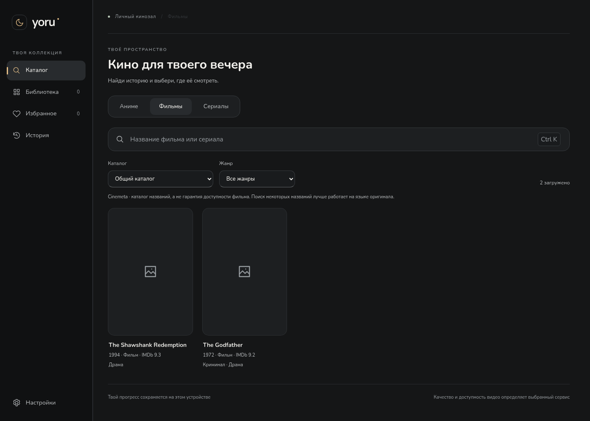
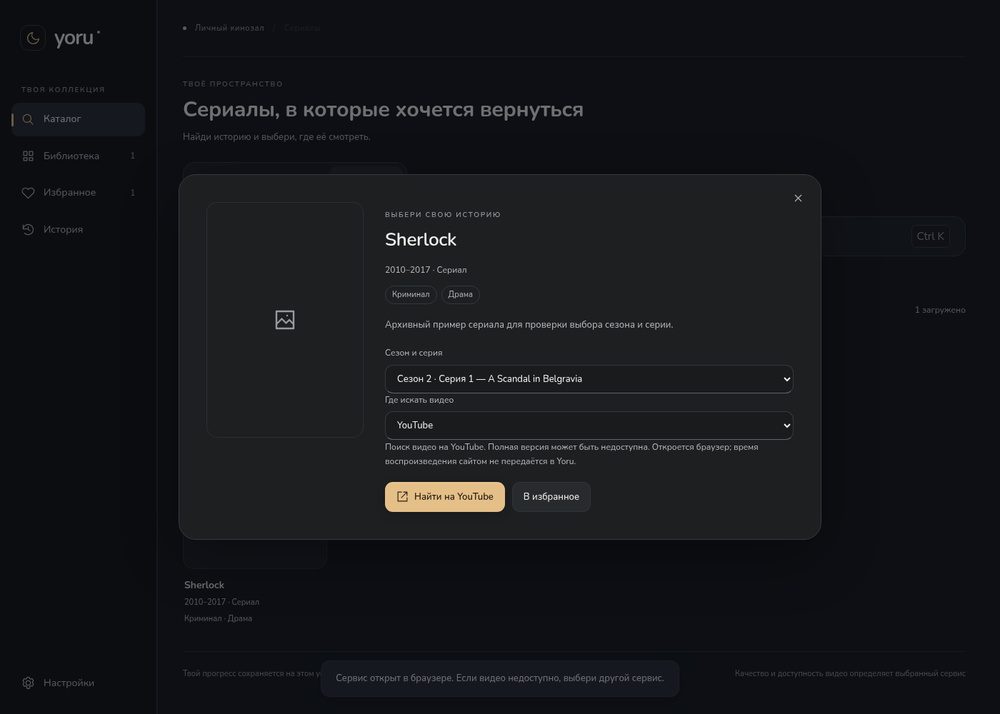
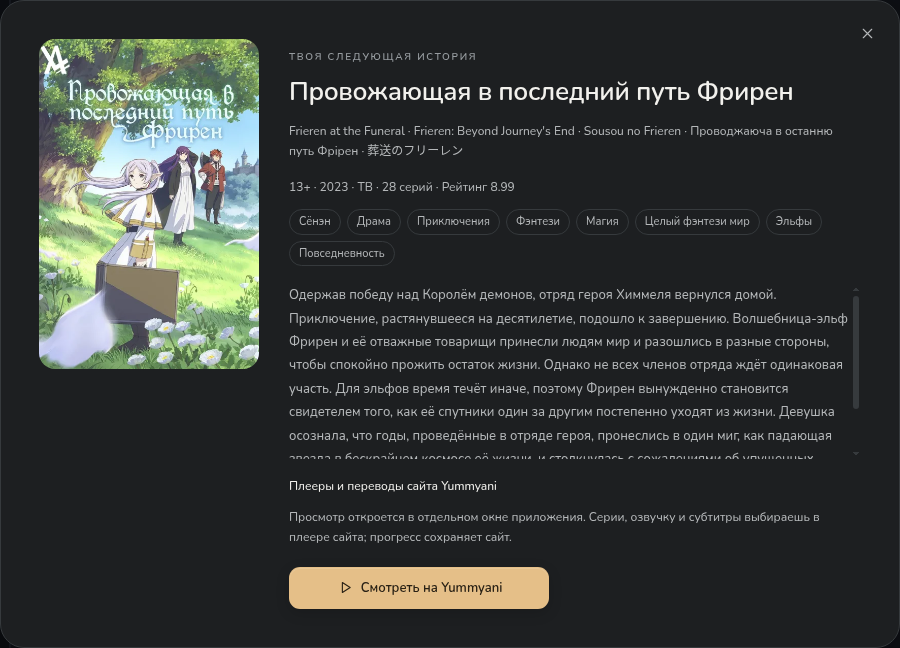
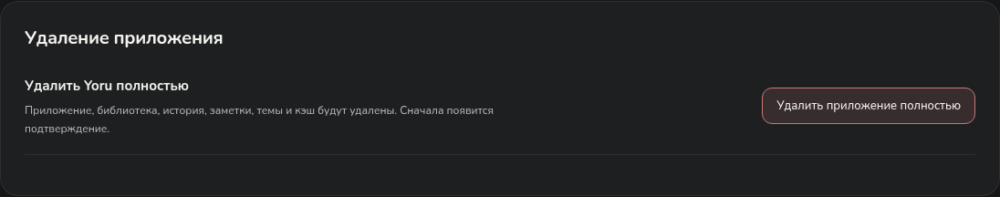

# Yoru — кино, сериалы и аниме


**Windows 10/11 · x64 · версия 0.9.0**

Три раздела в одном приложении: **Аниме / Фильмы / Сериалы**. Поиск, жанры, избранное, библиотека, темы и сохранение позиции встроенного просмотра.

Для аниме AniLibria доступен встроенный плеер; Yummyani открывается в отдельном окне Yoru. Для фильмов и сериалов доступны каталог метаданных и поиск в **YouTube, Кинопоиске, Rutube, VK Видео** в системном браузере. Это поиск на сервисах: наличие полной версии и региональные ограничения определяет сайт. Подтверждённые прямые файлы Internet Archive можно смотреть внутри приложения с резервными адресами того же файла.



Новые киносервисы пока **не подтверждены живой проверкой из РФ и других стран**. В этой облачной среде их домены отклоняются прокси; сетевой черновик сохранён и ожидает публикации. Тесты с контролируемыми ответами проверяют приложение, но не заменяют проверку внешнего видео.

## Установка

**[Скачать установщик Yoru 0.9.0](https://github.com/Duwkaf1/kinoteatr-xivivide/actions/runs/40641068165/artifacts/12795019779)** — около 103 MiB. Извлеки `Yoru-Setup-0.9.0-x64.exe` из ZIP GitHub, закрой прежний Yoru и нажми **«Установить»**. Установщик автономный, на русском, без прав администратора; библиотека и настройки сохраняются. Для загрузки артефакта GitHub нужен вход в аккаунт.

[Инструкция](docs/installer.md) · [ZIP без установки](https://github.com/Duwkaf1/kinoteatr-xivivide/actions/runs/40641068165/artifacts/12795318031) · [Успешная Windows-проверка](https://github.com/Duwkaf1/kinoteatr-xivivide/actions/runs/40641068165)

## Фильмы и сериалы

- Cinemeta: названия, описания, год, жанры, постеры и серии. Список жанров берётся из выбранного каталога.
- При отказе основного каталога — TVmaze для сериалов или Internet Archive для свободных фильмов. Смена источника обозначается; состав каталогов различается.
- Поиск на YouTube, Кинопоиске, Rutube и VK Видео получает название, год и выбранную серию. Переход в браузер позволяет сервису самостоятельно обработать вход, подписку и DRM.
- При недоступности каталога введённое название можно искать сразу на выбранном сервисе.
- Встроенный просмотр Internet Archive предлагается только при подтверждённых метаданных лицензии, языка и подходящего файла. Резервные адреса используют то же имя файла, MD5 и качество; прогресс восстанавливается только для того же файла.
- **Настройки → Дополнительно → Доступ к видеосервисам**: проверка соединения с публичными страницами без учётных данных. Она не подтверждает наличие или воспроизведение конкретного фильма.

**Автоматической передачи тайминга и озвучки между браузерными плеерами этих сервисов нет.** Сервисы выбираются вручную; история встроенного плеера не выдаётся за историю браузера. Доступность всех фильмов и непрерывность просмотра при полном отказе сети не гарантируются.



[Подробности 0.9.0 и ограничения проверки](docs/cinema-0.9.0.md) · [Прямой просмотр свободного фильма — тестовый пример](docs/images/cinema-archive.png) · [Резерв поиска при отказе каталогов](docs/images/cinema-fallback.png)

## Каталог аниме

- Плавный поиск: неподходящие карточки исчезают при вводе, оставшиеся перестраиваются. Уменьшение движения и режим производительности учитываются.
- До шести жанров, возрастной рейтинг, сброс фильтров и случайное аниме со всеми выбранными условиями. Возраст и жанры видны на карточках.
- Выбор между AniLibria и расширенным каталогом Yummyani.
- Поиск по названию, разделы **«Популярное», «Обновления», «Новинки»**, подгрузка следующих карточек.
- Карточка аниме с постером, описанием, жанрами, выбором доступной серии и избранным.
- Автоматическое добавление просмотренного аниме в библиотеку и история с продолжением на сохранённой серии и позиции.
- Основной и альтернативный плееры; переключение сохраняет позицию, паузу и звук.
- Качество выбирается из реально доступных вариантов. Перед повторным открытием обновляются временные адреса видео, чтобы старые ссылки не мешали запуску.
- При ошибке — понятное сообщение и повторная попытка. Отдельной страницы «Источники» с обязательными проверками больше нет.

Для встроенного просмотра подключён **каталог AniLibria/AniLiberty**: в живой проверке 25 октября 2026 года API вернул **1 904 релиза** с русской озвучкой. Это каталог этого провайдера, а не всех аниме мира. Часть релизов может иметь неполный список доступных серий или ограничения; приложение показывает фактическую доступность. Другие студии и оригинальная дорожка не приписываются этому провайдеру.

В поле **«Где искать» → «Yummyani»** доступен дополнительный каталог с поиском, жанрами, возрастами и случайным выбором. Нужная страница открывается кнопкой **«Смотреть на Yummyani»** в отдельном изолированном окне Yoru. Озвучки, серии, субтитры и прогресс там контролирует сайт; синхронизации с таймингом встроенного плеера нет. Точное общее число API этого сайта не сообщает, поэтому показывается число загруженных карточек.


[Фильтры и расширенный каталог](docs/catalog-0.8.1.md). Если постер Yummyani не загрузился, приложение запрашивает резервную обложку AniLibria или MyAnimeList/Jikan по точным идентификаторам релиза. Одного совпадения названия недостаточно: конфликтующие ID и неподтверждённый сезон оставляют заглушку. [Подробности 0.8.2](docs/release-0.8.2.md).



В живой проверке основной CDN намеренно отключён, а метаданные и резервные картинки загружены из настоящих сервисов. Проверены «Фрирен» и «Клинок, рассекающий демонов». Внешние метаданные могут содержать ошибки; автоматический подбор по похожему названию не используется. [Результаты](docs/live-posters-0.8.2.json).


[«Клинок, рассекающий демонов» через альтернативный плеер](docs/images/catalog-live-player-alternative.png) · [Как проверены поиск и фильтры](docs/catalog-0.8.1.md)

## Оформление и удобство

Пять готовых тем — **«Тёплая ночь», OLED, «Север», «Сакура», «Молочный»** — и **«Своя»** с цветами фона, панелей, текста, акцента и формой элементов. Личный выбор сохраняется при переключении тем.

В 0.8.0 исправлены форма и центрирование месяца. Собственная палитра автоматически получает читаемый текст на каждой поверхности, включая поля и боковую панель. Включённое по умолчанию **«Смягчать яркие фоны»** делает большие цветные поверхности спокойнее; переключатель позволяет оставить точные цвета. Исходные значения в палитре сохраняются в обоих случаях, исправление контраста работает всегда.

Ползунок **«Производительность → Баланс → Качество»** плавно следует за мышью и мягко останавливается на выбранном режиме. Клавиатура переключает режимы целиком. Описания не сдвигают ползунок при смене режима на узком окне.

- Производительность отключает декоративные эффекты и анимации, уменьшает количество карточек библиотеки и лимиты памяти медиакомпонентов.
- Качество добавляет мягкие переходы, объём обложек и танцующую пиксельную Мику в индикатор ожидания видео.
- Разрешение видео настраивается отдельно. Изменение оформления не перезапускает текущую серию.
- Локальный шрифт Nunito с кириллицей, SVG-иконки, прокрутка справа, клавиатурный фокус и поддержка уменьшения движения.


[Все 55 скриншотов](docs/images/README.md) · [Плавный ползунок](docs/images/performance-smooth.png) · [Пример формы элементов](docs/images/settings-radius-preview.png)

## Полное удаление

В установленной Windows-версии: **Настройки → Дополнительно → Удалить приложение полностью**. Системное окно перечислит удаляемые данные; по умолчанию выбрана **«Отмена»**. После подтверждения приложение закроется, а деинсталлятор удалит Yoru, библиотеку, историю, заметки, темы и кэш. Вернуть эти локальные данные после удаления нельзя.

Обычное удаление через настройки Windows сохраняет профиль. Посторонние файлы в папке установки и цели ссылок из профиля не удаляются. В ZIP без установщика и при запуске с отдельным профилем полное удаление из приложения недоступно.



## Сохранённые возможности

У каждого аниме свои прогресс, заметки и имена персонажей. В составе главные персонажи показаны перед второстепенными. Загрузка состава через AniDB и настройка сезона остаются отдельной дополнительной возможностью; автоматического полного состава каждого релиза и каждой серии пока нет.

Для собственной библиотеки сохранены дополнительные прямые MP4/WebM/HLS-источники, оригинальная озвучка, несколько переводов и текстовые/оформленные субтитры. Ручное добавление и импорт находятся в **Настройки → Дополнительно → данные библиотеки** и не нужны для каталога. Страницы сторонних сайтов открываются в изолированных окнах; их внутренними плеерами управляет сайт.

**30 секунд без продвижения видео** запускают переход к доступному резервному источнику той же серии и озвучки, затем учитывается сохранённый приоритет русских студий. Качество не снижается автоматически. Это работает при наличии подходящих резервных источников; единственный поток не превращается в несколько независимых плееров. Ручная пауза не считается сбоем.

[Восстановление просмотра](docs/recovery-0.7.7.md) · [Имена и заметки](docs/character-details.md) · [Субтитры и дополнительные источники](docs/viewing-0.6.md)

## Проверки версии 0.9.0

Код приложения и установщика — [`1cbe896`](https://github.com/Duwkaf1/kinoteatr-xivivide/commit/1cbe89662675409c1fb47a47c365fb89991bccea).

- **87 unit-тестов**, production-сборка и запуск настоящего Linux Electron прошли успешно.
- Новые проверки: смена разделов, быстрый поиск и отмена старых запросов, точный сезон/серия в ссылке сервиса, избранное, ошибка/повтор, резерв при отказе метаданных, Ctrl+K и окно 320×480.
- Нативный тест: H.264/AAC 1920×1080, отказ основного адреса, резерв того же файла, сохранение двух секунд и продолжение после перезапуска. Новые каталоги и сервисы отвечают контролируемыми данными; собственное короткое видео проверяет медиадвижок.
- **100 браузерных сценариев прошли за 4,9 минуты**. Семь новых сценариев кино проверяют в том числе сохранение жанра при отказе каталога и недоступное разрешение видео. Проверены и прежние темы, оба движка, звук, субтитры, персонажи, прогресс и настоящее ожидание 30 секунд при отказе источника.
- **Windows CI успешен:** тесты, сборка, запуск настоящего Electron, упаковка, установка и запуск установленного EXE, обновление, обычное и полное удаление с отменой/подтверждением, сохранность посторонних файлов и путь с кириллицей. Оба артефакта загружены.

Живые снимки и результаты аниме в этой документации получены в **0.8.2** из облачной сети и оставлены с исходной датой. Новые фильмы на этих снимках не проверялись. Реальные ответы Cinemeta/TVmaze/Archive, воспроизведение на YouTube/Кинопоиске, РФ и другие страны в 0.9.0 не подтверждены из-за сетевой политики среды. Физическое переключение DPI и звук Discord на пользовательском ПК также не проверены.

[Подробный отчёт 0.9.0](docs/cinema-0.9.0.md) · [История проверок](docs/validation.md) · [Прежний живой прогон аниме](docs/live-play-0.8.2.json)

## Запуск из исходников

Нужен **Node.js 24**.

```sh
npm ci
npm test
npm run build
npm start
```

```sh
npm run test:e2e
npm run test:desktop
npm run installer:win
```

Для установщика нужен бесплатный NSIS 3.11. `npm run package:win` собирает папку Windows-приложения. В облачной среде с унаследованным прокси используй `NODE_USE_ENV_PROXY=1`; TLS и проверка сертификатов остаются включены. Для Linux Electron нужен графический дисплей; браузерным тестам нужны Chromium и FFmpeg. [Сборка установщика](docs/installer.md).

## Данные и лицензии

Настройки, библиотека и заметки хранятся локально. Прежний профиль `kadr-anime` сохранён для совместимости. Временные адреса видео каталога не сохраняются в постоянной библиотеке: приложение запрашивает их заново перед просмотром.

Платные библиотеки не добавлены. Лицензии Electron, HLS.js, Video.js, libass-wasm и включённых шрифтов сохраняются в поставке. Nunito — SIL OFL. Постеры и кадры аниме принадлежат правообладателям; тестовые медиа и архивные изображения не включены в установщик.
