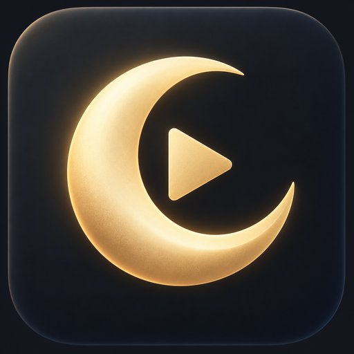
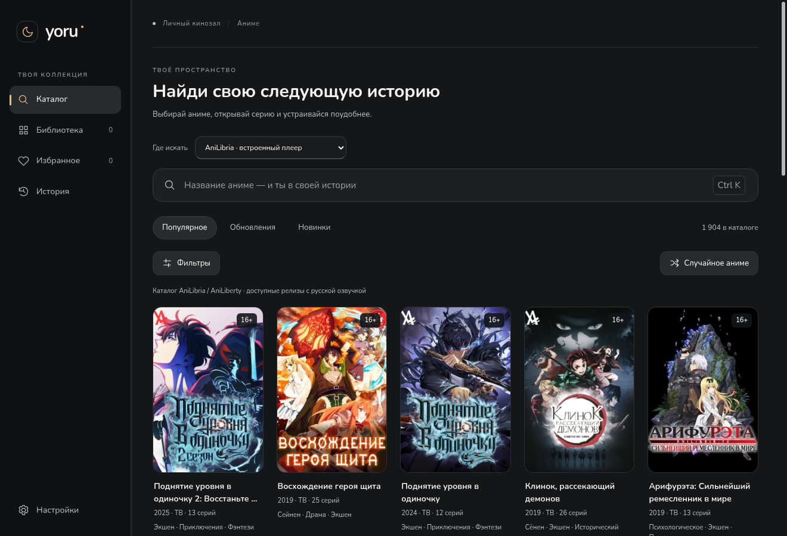
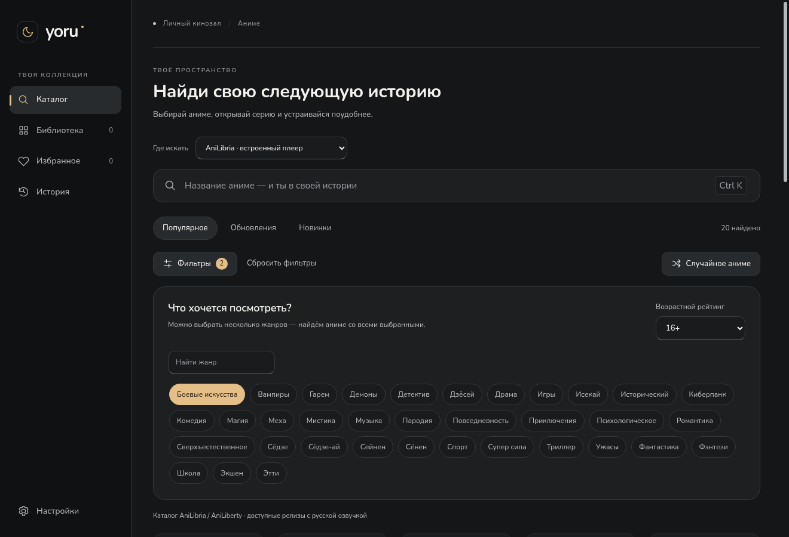
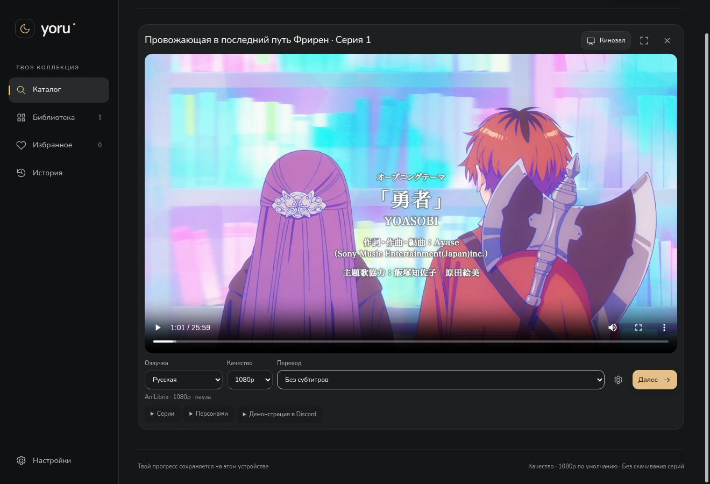
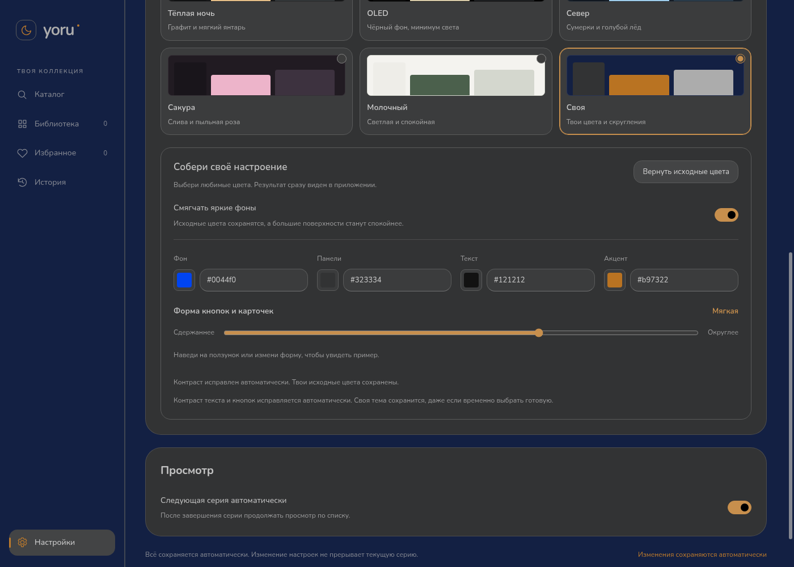

# Yoru — личный кинозал для аниме



**Windows 10/11 · x64 · версия 0.8.1**

Открой каталог, найди аниме по названию, жанрам и возрасту — или нажми **«Случайное аниме»**, чтобы получить вариант с теми же условиями. Для AniLibria выбери серию и нажми **«Смотреть»**. Название, постер, описание, серии и доступное видео загружаются автоматически. Вставлять ссылки для просмотра из каталога не нужно.



## Установка

**[Скачать установщик Yoru 0.8.1](https://github.com/Duwkaf1/kinoteatr-xivivide/actions/runs/40216458438/artifacts/12607517989)** — около 103 MiB. Извлеки `Yoru-Setup-0.8.1-x64.exe` из ZIP GitHub, закрой прежний Yoru и нажми **«Установить»**. Установщик автономный, на русском, без прав администратора; библиотека и настройки сохраняются. Для загрузки артефакта GitHub нужен вход в аккаунт.

[Инструкция](docs/installer.md) · [ZIP без установки](https://github.com/Duwkaf1/kinoteatr-xivivide/actions/runs/40216458438/artifacts/12607592697) · [Успешная Windows-проверка](https://github.com/Duwkaf1/kinoteatr-xivivide/actions/runs/40216458438)

## Каталог и просмотр

- Плавный поиск: неподходящие карточки исчезают при вводе, оставшиеся перестраиваются. Уменьшение движения и режим производительности учитываются.
- До шести жанров, возрастной рейтинг, сброс фильтров и случайное аниме со всеми выбранными условиями. Возраст и жанры видны на карточках.
- Выбор между AniLibria и расширенным каталогом Yummyani.
- Поиск по названию, разделы **«Популярное», «Обновления», «Новинки»**, подгрузка следующих карточек.
- Карточка аниме с постером, описанием, жанрами, выбором доступной серии и избранным.
- Автоматическое добавление просмотренного аниме в библиотеку и история с продолжением на сохранённой серии и позиции.
- Основной и альтернативный плееры; переключение сохраняет позицию, паузу и звук.
- Качество выбирается из реально доступных вариантов. Перед повторным открытием обновляются временные адреса видео, чтобы старые ссылки не мешали запуску.
- При ошибке — понятное сообщение и повторная попытка. Отдельной страницы «Источники» с обязательными проверками больше нет.

Для встроенного просмотра подключён **каталог AniLibria/AniLiberty**: в живой проверке 25 октября 2026 года API вернул **1 904 релиза** с русской озвучкой. Это каталог этого провайдера, а не всех аниме мира. Часть релизов может иметь неполный список доступных серий или ограничения; приложение показывает фактическую доступность. Другие студии и оригинальная дорожка не приписываются этому провайдеру.

В поле **«Где искать» → «Yummyani»** доступен дополнительный каталог с поиском, жанрами, возрастами и случайным выбором. Нужная страница открывается кнопкой **«Смотреть на Yummyani»** в отдельном изолированном окне Yoru. Озвучки, серии, субтитры и прогресс там контролирует сайт; синхронизации с таймингом встроенного плеера нет. Точное общее число API этого сайта не сообщает, поэтому показывается число загруженных карточек.



[Как работают фильтры и расширенный каталог](docs/catalog-0.8.1.md). В текущем облачном прогоне CDN постеров Yummyani заблокирован прокси, а повторная загрузка страницы сайта превысила 20 секунд; это ограничения живой проверки, а не подтверждение работы всех его плееров.



[«Клинок, рассекающий демонов» через альтернативный плеер](docs/images/catalog-live-player-alternative.png) · [Как проверены поиск и фильтры](docs/catalog-0.8.1.md)

## Оформление и удобство

Пять готовых тем — **«Тёплая ночь», OLED, «Север», «Сакура», «Молочный»** — и **«Своя»** с цветами фона, панелей, текста, акцента и формой элементов. Личный выбор сохраняется при переключении тем.

В 0.8.0 исправлены форма и центрирование месяца. Собственная палитра автоматически получает читаемый текст на каждой поверхности, включая поля и боковую панель. Включённое по умолчанию **«Смягчать яркие фоны»** делает большие цветные поверхности спокойнее; переключатель позволяет оставить точные цвета. Исходные значения в палитре сохраняются в обоих случаях, исправление контраста работает всегда.

Ползунок **«Производительность → Баланс → Качество»** плавно следует за мышью и мягко останавливается на выбранном режиме. Клавиатура переключает режимы целиком. Описания не сдвигают ползунок при смене режима на узком окне.

- Производительность отключает декоративные эффекты и анимации, уменьшает количество карточек библиотеки и лимиты памяти медиакомпонентов.
- Качество добавляет мягкие переходы, объём обложек и танцующую пиксельную Мику в индикатор ожидания видео.
- Разрешение видео настраивается отдельно. Изменение оформления не перезапускает текущую серию.
- Локальный шрифт Nunito с кириллицей, SVG-иконки, прокрутка справа, клавиатурный фокус и поддержка уменьшения движения.



[Все 47 скриншотов](docs/images/README.md) · [Плавный ползунок](docs/images/performance-smooth.png) · [Пример формы элементов](docs/images/settings-radius-preview.png)

## Сохранённые возможности

У каждого аниме свои прогресс, заметки и имена персонажей. В составе главные персонажи показаны перед второстепенными. Загрузка состава через AniDB и настройка сезона остаются отдельной дополнительной возможностью; автоматического полного состава каждого релиза и каждой серии пока нет.

Для собственной библиотеки сохранены дополнительные прямые MP4/WebM/HLS-источники, оригинальная озвучка, несколько переводов и текстовые/оформленные субтитры. Ручное добавление и импорт находятся в **Настройки → Дополнительно → данные библиотеки** и не нужны для каталога. Страницы сторонних сайтов открываются в изолированных окнах; их внутренними плеерами управляет сайт.

**30 секунд без продвижения видео** запускают переход к доступному резервному источнику той же серии и озвучки, затем учитывается сохранённый приоритет русских студий. Качество не снижается автоматически. Это работает при наличии подходящих резервных источников; единственный поток не превращается в несколько независимых плееров. Ручная пауза не считается сбоем.

[Восстановление просмотра](docs/recovery-0.7.7.md) · [Имена и заметки](docs/character-details.md) · [Субтитры и дополнительные источники](docs/viewing-0.6.md)

## Проверки версии 0.8.1

Проверенный код приложения — [`0197575`](https://github.com/Duwkaf1/kinoteatr-xivivide/commit/0197575831ddb7ee05a606f6cb514c8962739805).

- **72 unit-теста**, **86 браузерных сценариев**, production-сборка и запуск настоящего Linux Electron прошли успешно. После последних исправлений отдельно повторены все 16 сценариев каталога.
- Проверены поиск → карточка → серия → видео без ссылок, быстрый ввод/очистка/Enter, фильтры, случайный выбор и его отмена, переходы между каталогами, обработка ошибок, обновление временных адресов, сохранение прогресса, оба плеера, звук, субтитры, темы, формы, персонажи и восстановление после настоящего ожидания 30 секунд.
- Проверены малые окна, масштаб рендерера 100/125/150/200%, клавиатура и контраст собственных цветов.
- **Живая проверка без подмены API/медиа:** «Фрирен» и «Клинок, рассекающий демонов» воспроизведены в 1920×1080 со звуком, в разных движках; перемотка на минуту успешна. Отдельный сценарий проверяет случайный выбор из 58 релизов и отмену устаревшей следующей страницы. [Машиночитаемый результат](docs/live-play-0.8.1.json).
- **Windows CI успешен:** тесты, сборка, настоящий Electron, упаковка, установка, запуск установленного EXE, обновление, защита открытого приложения, удаление с сохранением данных и путь с кириллицей.

Живой просмотр проверен из облачной сети, не у российского провайдера. Доступность каждого релиза, отсутствие любых задержек, физическое изменение DPI мониторов и передача звука Discord на пользовательском ПК не подтверждены. Приложение не может гарантировать работу внешнего сервиса при его отказе.

[Подробный отчёт 0.8.1](docs/catalog-0.8.1.md) · [История проверок](docs/validation.md)

## Запуск из исходников

Нужен **Node.js 24**.

```sh
npm ci
npm test
npm run build
npm start
```

```sh
npm run test:e2e
npm run test:desktop
npm run installer:win
```

Для установщика нужен бесплатный NSIS 3.11. `npm run package:win` собирает папку Windows-приложения. В облачной среде с унаследованным прокси используй `NODE_USE_ENV_PROXY=1`; TLS и проверка сертификатов остаются включены. Для Linux Electron нужен графический дисплей; браузерным тестам нужны Chromium и FFmpeg. [Сборка установщика](docs/installer.md).

## Данные и лицензии

Настройки, библиотека и заметки хранятся локально. Прежний профиль `kadr-anime` сохранён для совместимости. Временные адреса видео каталога не сохраняются в постоянной библиотеке: приложение запрашивает их заново перед просмотром.

Платные библиотеки не добавлены. Лицензии Electron, HLS.js, Video.js, libass-wasm и включённых шрифтов сохраняются в поставке. Nunito — SIL OFL. Постеры и кадры аниме принадлежат правообладателям; тестовые медиа и архивные изображения не включены в установщик.
