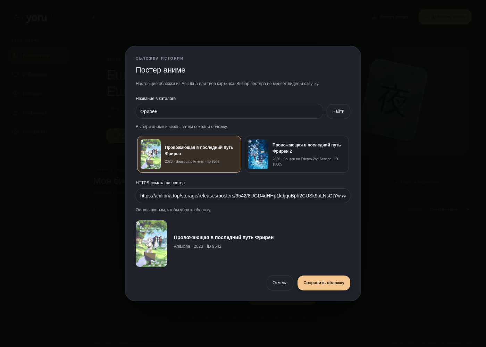

# Yoru — Windows-плеер для аниме

В локальной версии **Yoru 0.5.0** буквенные карточки заменены настоящими постерами, фон боковой панели и страницы стал единым. Нижние подписи убраны; темы, собственная палитра и подробные параметры доступны в «Настройках».

**Ниже — снимки локальной версии 0.5.0. В публичной ветке `main` пока опубликован код прежней версии 0.2 под названием «Кадр». Новый код не отправлен в открытый репозиторий.**

### Библиотека с постерами аниме


Все PNG в [docs/images](docs/images) обновлены для 0.5. Старые изображения с буквами и прежним дизайном удалены. Показана тестовая библиотека с настоящими названиями и соответствующими обложками; после установки библиотека пустая. На скриншотах нет подключённого каталога видеопотоков.

### Поиск и выбор обложки

В локальной версии нажми **«Выбрать»** при добавлении аниме или **«Обложка»** под существующей карточкой. Найди русское или английское название, выбери нужный сезон из AniLibria и сохрани постер. Также можно вставить свою HTTPS-ссылку или убрать картинку. Выбор сохраняется после перезапуска и не меняет видео или озвучку; ошибка изображения не останавливает просмотр. [Как устроены постеры](docs/posters.md).



### Темы и настройки

[Светлая тема](docs/images/settings-cream.png) · [Сакура](docs/images/settings-sakura.png) · [Своя палитра](docs/images/settings-custom.png) · [Подробные настройки](docs/images/settings-manual.png)

## Опубликованная версия 0.2 — прежнее название «Кадр»

Ранняя версия 0.2. Каталоги внешних сайтов пока не подключены: текущая библиотека наполняется прямыми видеоссылками или импортом JSON. Нельзя вставить страницу сайта вместо MP4, WebM или HLS-манифеста и ожидать автоматического извлечения видео.

## Интерфейс и производительность в 0.2

- Тёмная тема с тёплыми акцентами, векторными иконками и типографическими обложками без внешних запросов. Демонстрационные названия на скриншотах созданы только в тестах: при установке библиотека пустая.
- Блок продолжения последнего просмотра, сортировка и поиск по всей библиотеке; карточки выводятся порциями по 24 с кнопкой «Показать ещё».
- Кнопка «Кинозал» скрывает боковую панель и библиотеку. Escape возвращает обычный вид. F переключает полноэкранный режим, M — звук, пробел — паузу, стрелки — перемотку на 10 секунд. В полях ввода горячие клавиши не перехватываются.
- Короткие анимации появления и наведения без постоянно движущихся фонов и тяжёлого размытия. Системная настройка уменьшения движения и кнопка «Меньше анимаций» отключают эффекты.
- HLS-модуль загружается только при открытии HLS-видео. Начальный JS: 22.46 КБ вместо 589.19 КБ (без gzip), при воспроизведении HLS дополнительно загружается модуль 575.28 КБ.
- Прогресс хранится отдельно от библиотеки: запись каждые 3 секунды больше не сериализует все серии и источники. Профиль версии 0.1 читается без потери избранного и истории.
- Зависимость HLS нужна только на этапе сборки и исключена из Node-зависимостей распространяемого приложения; собранный браузерный модуль остаётся внутри приложения.

Замеры в облачном Chromium и их ограничения: [performance.md](docs/performance.md). Они не подтверждают FPS, расход всей памяти Electron или работу на конкретном Windows-компьютере.

## Что реализовано

- Личная библиотека с поиском, избранным и историей на этом устройстве.
- Воспроизведение прямых HTTPS-ссылок MP4/WebM/HLS. Поддержка конкретного кодека зависит от Chromium/Electron.
- Сохранение позиции, ручной выбор серии и автоматический переход к следующей серии из импортированного списка.
- Приоритет источников: AniDUB → AniLibria/AniLiberty → другая русская озвучка. Автоматический выбор только при явной отметке `language: "ru"`; программа не распознаёт язык звука самостоятельно.
- Две попытки на источник, затем следующий источник выбранного качества; таймер зависания 15 секунд во время воспроизведения. Ручная пауза не вызывает переключение.
- Выбранное качество не снижается автоматически. Для HLS с мастер-плейлистом выбирается точное разрешение; для одиночного потока/MP4 качество берётся из данных источника.
- Ограниченный буфер HLS в памяти, без скачивания серий. HTTP-кэш Electron отключён; библиотека и прогресс сохраняются как метаданные.
- Два пользовательских сайта в разделе «Источники». Открываются в отдельных изолированных окнах без Node.js, доступа к файлам приложения и загрузок. Управление их внутренними плеерами пока не реализовано.

Нет гарантии непрерывности при недоступности сети и всех источников. Позиция переносится в секундах между указанными пользователем версиями одной серии; разные монтажи могут расходиться. Обновление истёкших ссылок и получение независимых резервных потоков потребуют адаптеров сайтов.

## Запуск и сборка

Нужен Node.js 24 (минимум 22.12 для инструментов сборки).

```sh
npm ci
npm test
npm run build
npm start
```

На Windows сборка папки приложения:

```sh
npm run package:win
```

Запускай `artifacts/Kadr-win32-x64/Kadr.exe`. Для переноса нужна **вся папка**, а не один EXE. Сборка не подписана; реальный запуск и захват звука Discord на Windows ещё не проверены.

Для ZIP-архива в среде с Python 3.11+: `python3 scripts/archive-win.py`. Скрипт проверяет целостность созданного архива и сохраняет рядом SHA256. Лицензия включённого в сборку HLS-плеера сохраняется в `LICENSE-hls.js.txt`.

В облачной Linux-среде для npm используй доступный каталог кэша: `npm --cache /workspace/.npm-cache ci`. Для кросс-сборки с унаследованным HTTP-прокси: `NODE_USE_ENV_PROXY=1 npm run package:win`. Загрузка Electron проверяет официальные контрольные суммы; не отключай TLS или проверки целостности.

`npm run dev` запускает интерфейс в браузере для разработки, а не Windows-приложение. Не рассчитывай на сохранение процесса сервера при восстановлении облачной среды.

## Список серий и резервных источников

Скопируй структуру из [playlist.example.json](docs/playlist.example.json), укажи свои прямые видеоссылки и импортируй файл кнопкой «Импорт списка». Домены `.invalid` в примере намеренно не работают. Повторяющиеся ID отклоняются без перезаписи существующих записей. Порядок серий в массиве задаёт порядок автоматического перехода. Для разного качества добавляются отдельные источники с `quality` 480/720/1080.

Данные библиотеки и ссылки хранятся локально в профиле приложения. Не публикуй файл со ссылками, содержащими личные токены.

## Проверки

```sh
npm test
npm run test:e2e
npm run test:desktop
```

Браузерные проверки используют установленный Chromium (`CHROMIUM_PATH`, по умолчанию `/usr/bin/chromium`) и FFmpeg для генерации короткого собственного тестового видео со звуком. Внешнее аниме не загружается. Они проверяют библиотеку, прогресс, отказы источников, языковой фильтр, качество и переход серии. Они не заменяют проверку на Windows.

`npm run test:desktop` запускает настоящий Electron с production-сборкой (`npm run build` перед тестом), отдельным временным профилем и собственным небольшим WebM-видео. Проверяет запуск через `file://`, preload, воспроизведение, сохранение библиотеки после перезагрузки, изоляцию окон источников и завершение приложения. На Linux нужен графический дисплей; в этой облачной среде проверка выполнена с виртуальным Xorg-дисплеем. Только для такого изолированного Linux-тестирования доступна переменная `KADR_ELECTRON_NO_SANDBOX=1`; обычное приложение и Windows-проверка не отключают sandbox.

GitHub Actions (`.github/workflows/windows.yml`) выполняет unit-тесты, настоящую desktop-проверку и сборку на `windows-latest`; ZIP сохраняется в артефактах успешного запуска. Наличие workflow не означает, что конкретный запуск уже прошёл: смотри его статус в разделе Actions.

Для Discord: в установленном клиенте выбери демонстрацию окна «Кадр» с передачей звука и проверь её со вторым участником. Для страниц источников выбирай соответствующее окно источника. При чёрном изображении можно проверить запуск с `--disable-gpu`. Программа не управляет настройками Discord и не обходит защиту видео.

## Что блокирует интеграцию сайтов

Первоначально запросы блокировал облачный прокси. После применения сетевых настроек повторная проверка 24 октября дала HTTP 403 для `g0e-1ka1v5q.troutcdn.site/283290` и HTTP 404 для `brogiro.cfd/series/283290/`. Причины этих ответов не установлены; они не доказывают недоступность сайтов с другого IP/VPN. Воспроизведение по этим страницам не подтверждено. Нужно исследовать доступные страницы, iframe/плееры, механизм выбора озвучек и серий, затем реализовать и проверить адаптеры. Совпадающий ID в двух URL не доказывает, что это независимые источники видео.

Подробности: [исследование источников](docs/source-research.md).

Результат проверки перед публикацией исходников: [validation.md](docs/validation.md).
