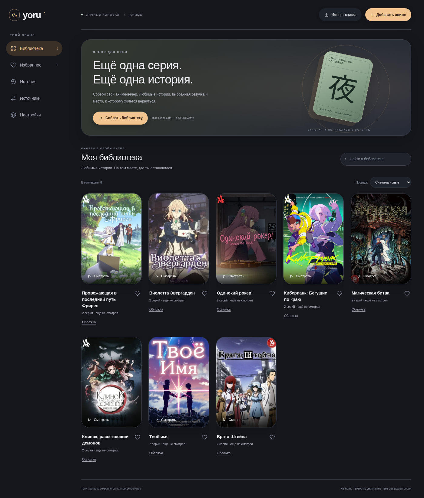
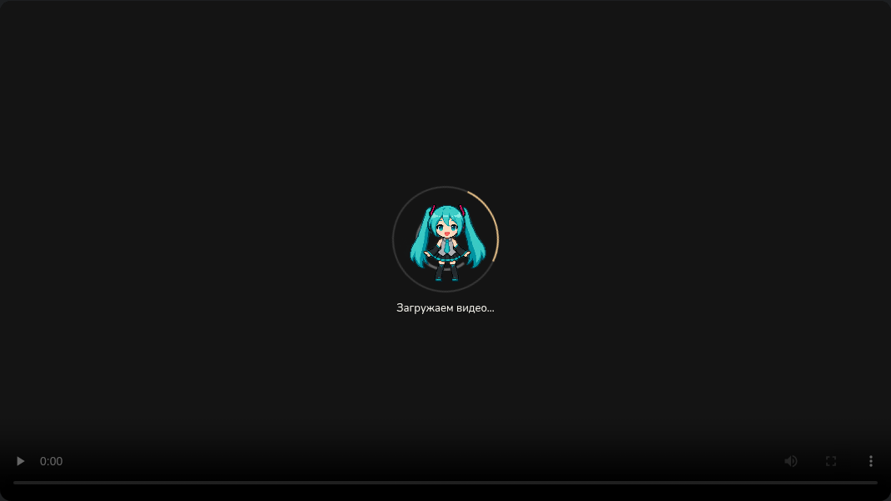
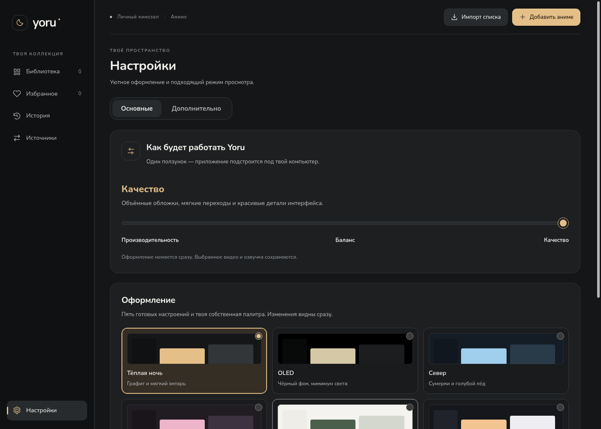
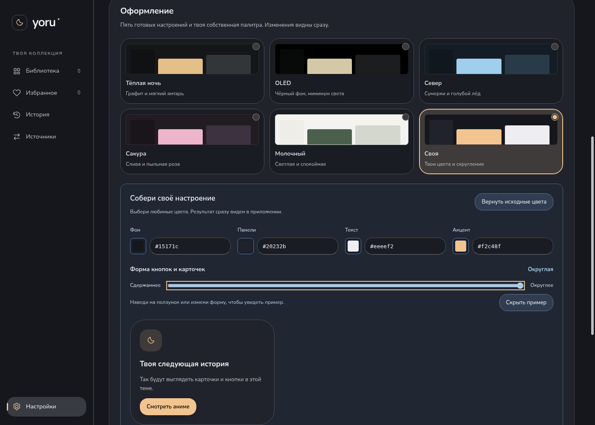
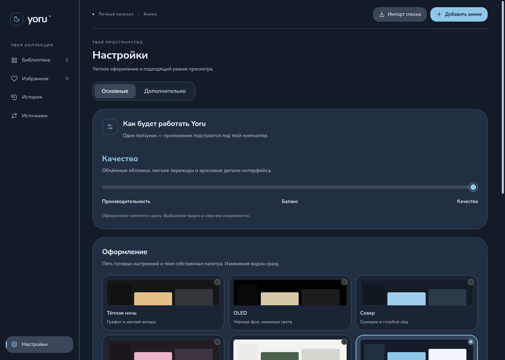
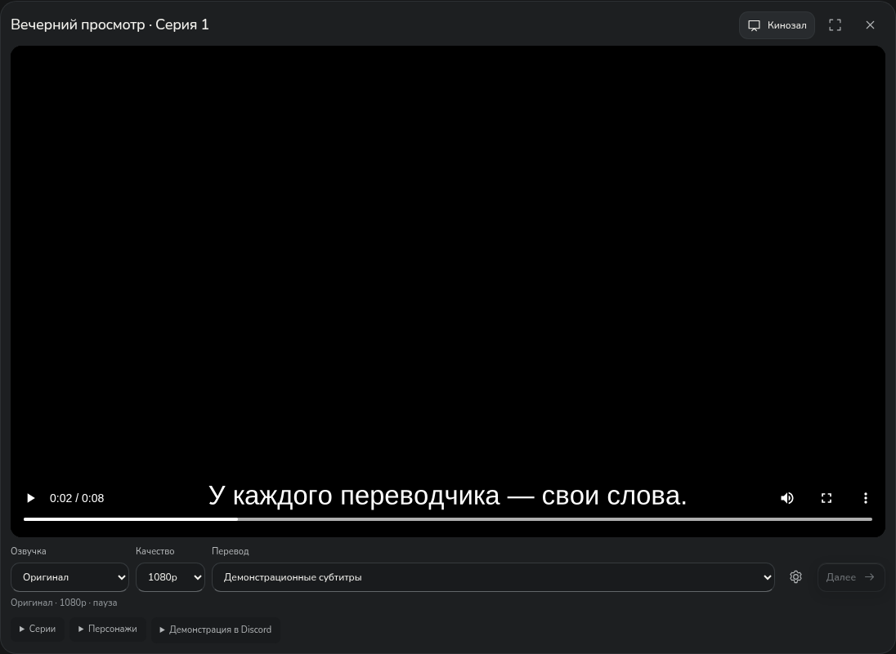
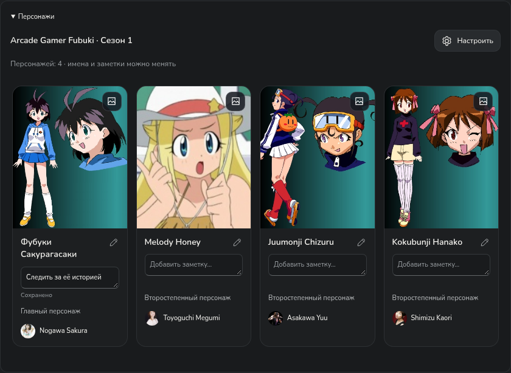

# Yoru — скриншоты интерфейса

Галерея содержит **37 PNG** реализованного интерфейса 0.7.6. Все снимки заново получены общим прогоном 65 браузерных сценариев. Полоса прокрутки не скрывается тестовым браузером; показаны обычные окна, а не сжатая высокая страница. Предыдущие снимки заменены. Библиотека подготовлена для проверок; после установки приложение пустое. Видео — собственный короткий тестовый фрагмент, не поток аниме.

## Библиотека и навигация

[Избранное](favorites.png) · [История](history.png) · [Источники](sources.png) · [Компактное окно](window-compact.png)

## Загрузка в режиме «Качество»

В приложении это восемь танцующих кадров, здесь показан один. Другие режимы, выключенные анимации и уменьшение движения не загружают спрайт. Изображение не является кадром аниме.

## Простые настройки

Две вкладки, ползунок «Производительность / Баланс / Качество» и встроенный округлый шрифт Nunito. В основных нет технических параметров загрузки видео. «Настройки» остаются внизу неподвижной боковой панели.

Кнопка примера появляется при наведении, изменении или фокусе ползунка. Точный результат виден на реальных стилях приложения. Клавиатура и своя палитра поддерживаются.

## Темы

| Тема | Снимок |
| --- | --- |
| Тёплая ночь | [Настройки](settings-night.png) |
| OLED | [Настройки с чёрным фоном](settings-oled.png) |
| Север | [Настройки](settings-nord.png) |
| Сакура | [Настройки](settings-sakura.png) |
| Молочный | [Светлые настройки](settings-cream.png) |
| Своя | [Собственные цвета и скругление](settings-custom.png) |
| Ручные параметры | [Подробная настройка](settings-manual.png) |

В версии 0.7.5 обновлены четыре снимка плеера и форм: тестовый перевод явно называется «Демонстрационные субтитры». Остальные снимки показывают неизменившиеся экраны 0.7.4.

## Просмотр и диалоги

[Параметры просмотра](player-settings.png) · [Добавление аниме](add-dialog.png) · [Выбор постера](poster-picker.png) · [Добавление источника](media-dialog.png) · [Добавление перевода — нижняя часть прокручиваемой формы](subtitle-dialog.png)

## Персонажи

[Упрощённые настройки персонажей](cast-settings.png) · [Редактирование имени](character-name-dialog.png) · [Выбор фотографии](character-photo-dialog.png)

Состав на снимке — четыре персонажа Arcade Gamer Fubuki из публичного архива XML AniDB релиза 128. Восемь фотографий персонажей/сэйю получены с CDN AniDB. Русское имя и заметка первой героини — пример личных подписей, не перевод из источника. Архив не выдаётся за свежий ответ API или полный состав по сериям.

## Пустые списки, ошибки и доступность

[Пустая библиотека в OLED](empty-library.png) · [Нет результатов поиска](search-empty.png) · [Ошибка импорта](import-error.png) · [Клавиатура и системные контрастные цвета](keyboard-high-contrast.png)

## Эмуляция масштаба

| Масштаб | Библиотека | Настройки |
| --- | --- | --- |
| 100% | [Снимок](scale-100-library.png) | [Снимок](scale-100-settings.png) |
| 125% | [Снимок](scale-125-library.png) | [Снимок](scale-125-settings.png) |
| 150% | [Снимок](scale-150-library.png) | [Снимок](scale-150-settings.png) |
| 200% | [Снимок](scale-200-library.png) | [Снимок](scale-200-settings.png) |

Здесь deviceScaleFactor 1/1.25/1.5/2 и соответствующий CSS-размер окна. Проверяется адаптация рендерера, а не физическое переключение DPI Windows. Отдельно выполнена проверка zoom настоящего Electron и окна 640×480. Полные страницы прокручиваются; прокрутка форм также предусмотрена.

Постеры получены из AniLibria, фотографии — из AniDB; права принадлежат правообладателям. Тестовые изображения не включены в Windows-пакет. [Обложки](../posters.md) · [Фотографии](../character-photos.md) · [Имена и заметки](../character-details.md) · [Дизайн-система и проверки](../redesign-0.7.md).

## Повторить снимки

После успешного полного `npm run test:e2e` выполни `node scripts/update-gallery.js`. Скрипт сначала проверяет наличие всех снимков и затем копирует их в галерею. Для персонажей используется подготовленный состав с фотографиями (`character-photos.png`), а не диагностический экран ручных отметок серий.
